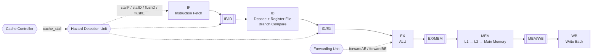
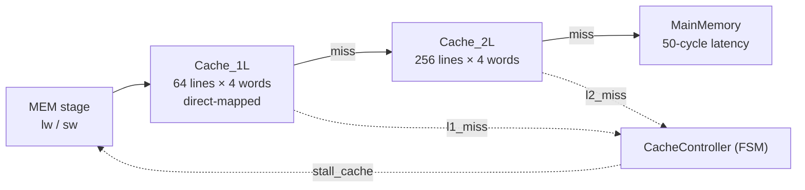

# 5-Stage Pipelined MIPS Processor with Two-Level Cache

A fully pipelined 32-bit MIPS processor written in **Verilog**, featuring data forwarding, load-use hazard detection, branch flushing, and a **two-level cache hierarchy** (L1 + L2) backed by a slow main memory. Cache misses freeze the whole pipeline through a dedicated cache controller.

> Computer Architecture Laboratory, final project (last phase of the MIPS lab series), Khordad 1405 (June 2026).
> Instructor: Dr. Manavi. Teaching assistants: Mohammad Baghaei, Saeed Paknit, Aslan Moradi Alamdarlou.

**Author:** Moein Yeganeh


---

## Table of Contents

- [Overview](#-overview)
- [Pipeline Architecture](#-pipeline-architecture)
- [Hazard Handling](#-hazard-handling)
- [Memory System](#-memory-system)
- [Module Reference](#-module-reference)
- [Verification](#-verification)
- [Running the Simulation](#-running-the-simulation)
- [Implementation Notes](#-implementation-notes)
- [Author](#-author)
- [License](#-license)

---

## Overview

The earlier phases of the lab produced a single-cycle MIPS processor with a basic cache. This final phase turns it into a complete pipelined CPU:

| Area | What was built |
|---|---|
| **Datapath** | Five stages (IF, ID, EX, MEM, WB) separated by four pipeline registers |
| **Control** | Control signals generated in ID and carried through the pipeline registers to the stage that uses them |
| **Data hazards** | Forwarding unit (EX/MEM and MEM/WB to the ALU inputs) plus load-use stall |
| **Control hazards** | Branches resolved in ID, with IF/ID flushed when a branch is taken |
| **Memory system** | Two-level cache (L1 and L2) with a cache controller FSM and a 50-cycle main memory |
| **Verification** | Integrated testbench with branches, nested loops, and heavy memory access |

---

## Pipeline Architecture



### Pipeline registers

| Module | Carries | Special inputs |
|---|---|---|
| `IF_ID_reg` | `pc_plus4`, `instr` | `stallD` (hold), `flushD` (clear on taken branch) |
| `ID_EX_reg` | Register data 1 and 2, sign-extended immediate, `rs`/`rt`/`rd`, and all EX, MEM, and WB control signals | `flushE` (bubble injection) |
| `EX_MEM_reg` | ALU result, store data, selected destination register, MEM and WB control signals | none |
| `MEM_WB_reg` | Memory read data, ALU result, destination register, WB control signals | none |

Control signals by the stage that consumes them:

| Stage | Signals |
|---|---|
| EX | `alu_op[2:0]`, `alu_src`, `reg_dst` |
| MEM | `mem_read`, `mem_write`, `branch` |
| WB | `reg_write`, `mem_to_reg` |

All pipeline registers use **non-blocking assignments** (`<=`) inside `always @(posedge clk)`. While `cache_stall` is active, every pipeline register holds its previous value.

---

## Hazard Handling

### Forwarding Unit

Removes most data hazards by feeding the ALU with the newest computed value before it reaches the register file.

| `forwardAE` / `forwardBE` | ALU operand source |
|---|---|
| `00` | Value read from the register file (ID/EX register) |
| `01` | Result being written back in WB (`MEM/WB`) |
| `10` | ALU result in MEM (`EX/MEM`) |

A forward only happens when the producing stage has `reg_write` active **and** its destination register is not `$0`, matching the source register `rs` (A) or `rt` (B) in EX. The MEM stage takes priority over WB because it holds the newer value.

### Hazard Detection Unit

| Situation | Reaction |
|---|---|
| **Load-use**: `lw` in EX writes a register that the instruction in ID needs | `stallF = 1`, `stallD = 1`, `flushE = 1` (one-cycle bubble) |
| **Taken branch** (decided in ID) | `flushD = 1` clears the wrongly fetched instruction |
| **Cache miss** (`cache_stall` from the cache controller) | Whole pipeline frozen until the memory system answers |

---

## Memory System

Memory accesses from the MEM stage go through a two-level cache.



| Level | Organization | Write policy | Latency |
|---|---|---|---|
| **L1** (`Cache_1L`) | Direct-mapped, 64 lines, 4-word blocks | Write-through, no-write-allocate | Hit: 0 stall cycles |
| **L2** (`Cache_2L`) | 256 lines, 4-word blocks | Write-back, write-allocate | Hit: 3 cycles |
| **Main memory** (`MainMemory`) | `reg [31:0] mem [0:1023]` behind a small state machine | n/a | 50 cycles, then `ready_mem_main` is asserted |

### Access flow

1. A `lw` or `sw` from MEM reaches L1.
2. **L1 hit:** data returns in the same cycle and `stall = 0`.
3. **L1 miss:** L1 raises `l1_miss`, the cache controller sets `cache_stall = 1`, freezing the pipeline, and forwards the request to L2.
4. **L2 hit:** the block reaches L1 after 3 cycles, `l2_ready` is asserted, and `cache_stall` drops.
5. **L2 miss:** L2 requests the block from main memory. After the memory latency the block is stored in L2 and also sent to L1, then `cache_stall` drops.

---

## Module Reference

| Module | Role |
|---|---|
| `IF_ID_reg`, `ID_EX_reg`, `EX_MEM_reg`, `MEM_WB_reg` | Pipeline registers |
| `ForwardingUnit` | Generates `forwardAE` and `forwardBE` |
| `HazardDetectionUnit` | Generates `stallF`, `stallD`, `flushD`, `flushE` |
| `Cache_1L` | First-level cache |
| `Cache_2L` | Second-level cache |
| `CacheController` | FSM coordinating L1, L2, and main memory; produces `cache_stall` |
| `MainMemory` | Slow backing store |
| Top module | Integrates the pipelined datapath, hazard logic, and memory system |

Key interfaces:

```verilog
// Forwarding
input  [4:0] rsE, rtE, write_regM, write_regW;
input        reg_writeM, reg_writeW;
output reg [1:0] forwardAE, forwardBE;

// Hazard detection
input  [4:0] rsD, rtD, rtE;
input        mem_to_regE, branch_takenD, cache_stall;
output reg   stallF, stallD, flushD, flushE;

// Cache controller
input        clk, rst, l1_miss, l2_miss;
output reg   l2_req, cache_stall;
```

---

## Verification

An **integrated testbench** runs a program that stresses everything at once:

- branches and taken or not-taken jumps (flush logic)
- nested loops
- back-to-back dependent instructions (forwarding)
- `lw` immediately followed by a dependent instruction (load-use stall)
- heavy `lw` and `sw` traffic hitting and missing in L1 and L2 (cache stalls)

---

## Running the Simulation

Any Verilog simulator works (ModelSim/Questa, Vivado, Icarus Verilog). With Icarus Verilog, from the folder that contains the source files:

```bash
iverilog -g2012 -o pipeline_sim *.v
vvp pipeline_sim
```

To inspect waveforms in ModelSim or Questa, load the top-level testbench and run it with `run -all`.

---

## Implementation Notes

- Branch decisions are taken in the **ID stage**, so a taken branch costs one flushed instruction.
- `cache_stall` has the highest priority: no pipeline register may change while it is high.
- Register `$0` is never forwarded.
- Main memory is deliberately slow (50 cycles) so the benefit of the L1 and L2 levels is visible in simulation.

---

## Author

**Moein Yeganeh**

---

## License

This project is licensed under the [MIT License](LICENSE).
